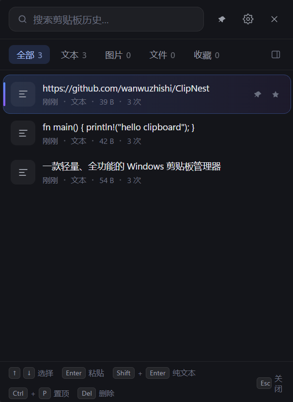

# ClipNest

**English** | [简体中文](README.md)

A lightweight, full-featured clipboard manager for Windows. Lives in the tray, opens with one hotkey, and brings back text, images and files you copied earlier.



> Stack: Tauri 2 + Rust + React + SQLite — everything stored locally, no network
> License: MIT · single-file exe, ~4.8 MB

[](https://github.com/wanwuzhishi/ClipNest/releases)
[](LICENSE)
[](https://github.com/wanwuzhishi/ClipNest/releases)

## Features

### Capture

- Event-driven listener (`AddClipboardFormatListener` + `WM_CLIPBOARDUPDATE`) — zero idle CPU, no polling
- Text, HTML/RTF, images (`PNG` / `CF_DIB` / `CF_DIBV5`), files and folders
- SHA-256 content dedupe: copying the same thing again just bumps a counter

### Panel

- Global hotkey (`Alt+V` by default), appears next to the cursor
- **Never steals focus** — the window is created with `WS_EX_NOACTIVATE`, so an Explorer search box or a browser address bar keeps its text and cursor
- Keyboard works through a low-level hook, not window focus
- Click outside to dismiss (when not pinned, configurable in settings)
- 410 px collapsed (single column) · click the square icon to expand to 820 px with a preview pane
- Search, type filters (all / text / image / files / favorites), inline pin & favorite buttons, native Win11 rounded corners
- Text entries are editable in the preview pane

### Paste

- Remembers the foreground window *and* the exact focused control (`GetGUIThreadInfo`), restores both before sending Ctrl+V
- Writes multiple formats at once (text + HTML + RTF + PNG + DIB) so pasting into Word or a browser keeps formatting
- Adaptive delay: ~6 ms when focus never moved, 18–45 ms only when a switch is actually required

### Privacy (on by default)

- **Process exclusions** — copies made by password managers (KeePass, KeePassXC, 1Password, Bitwarden, LastPass, Dashlane, Enpass, Keeper, NordPass, RoboForm) are never recorded
- **Sensitive content detection** — PEM private keys, AWS `AKIA` keys, GitHub/Slack tokens, OpenAI `sk-` keys, JWTs and Luhn-validated card numbers are skipped
- Honours clipboard ignore markers (`ExcludeClipboardContentFromMonitorProcessing`, `Clipboard Viewer Ignore`)
- Every record stores its source process name

### Misc

- Tray menu, autostart, retention policy (by count / days), single instance
- `Ctrl+L` pins the panel so it stays open after pasting — handy for pasting several items in a row
- Optional "single click to paste" in settings
- Per-monitor DPI aware

## Download

Grab `ClipNest.exe` from [Releases](https://github.com/wanwuzhishi/ClipNest/releases) and run it. No installer, no runtime needed (WebView2 ships with Windows 10/11).

## Build

```bash
npm install
npm run app:dev      # dev with hot reload
npm run app:build    # produce the installer
```

Manual release build:

```bash
npm run build                                        # frontend -> dist/
touch src-tauri/src/main.rs                          # force re-embed
cargo build --release --features custom-protocol --manifest-path src-tauri/Cargo.toml
```

> `--features custom-protocol` is required. Without it Tauri treats the exe as a dev build and
> loads `devUrl` (localhost:1420) instead of the embedded assets.

Output: `src-tauri/target/release/clipnest.exe`

> The frontend is embedded at compile time via `generate_context!`, so you must rebuild the Rust crate after changing the frontend.

## Shortcuts

| Action | Key |
|---|---|
| Show / hide panel | `Alt+V` (configurable) |
| Type in search | click the search box (activates the panel) |
| Move selection | `↑` `↓` |
| Paste | `Enter` |
| Paste as plain text | `Shift`+`Enter` |
| Pin / unpin selected item | `Ctrl+P` |
| Pin the panel (stay open) | `Ctrl+L` or the pin icon |
| Delete selected item | `Delete` |
| Quick-paste top 9 | `1`–`9` (cursor over the panel) |
| Close panel | `Esc` or the × button |

## Keyboard takeover policy

Because the panel never takes focus, the keyboard is captured through a global low-level hook — which means ClipNest has to decide whether a keypress belongs to the panel or to the window underneath:

| Situation | Behaviour |
|---|---|
| Cursor is over the panel | Full shortcut set (↑↓ / Enter / Del / Ctrl+P / Ctrl+L / 1-9) |
| Within 3 s of opening | Only Esc / ↑ / ↓ / Enter are captured, everything else passes through |
| Panel open but you're working elsewhere | First non-Esc key closes the panel and is delivered to the original window |
| **Pinned (`Ctrl+L`), cursor off the panel** | Only Esc is captured; everything else passes through and the panel stays |

That way Enter in an Explorer search box, `Ctrl+P` in VS Code, or `Delete` in a file manager are never swallowed.

## Data location

```
%APPDATA%\com.alma.clipnest\
├─ clipnest.db      history (SQLite, WAL)
├─ media\           image blobs
└─ settings.json    settings
```

## Project structure

```
src/                 React frontend (panel + settings)
src-tauri/src/
├─ lib.rs            startup, tray, hotkeys, window placement
├─ clipboard.rs      Win32 clipboard read/write + listener
├─ keyhook.rs        global keyboard & mouse hooks
├─ paste.rs          focus restore + Ctrl+V injection
├─ privacy.rs        process exclusion, sensitive content, ignore markers
├─ store.rs          SQLite data layer
└─ commands.rs       IPC commands
docs/research.md     competitor feature research
PLAN.md              milestone checklist (Chinese)
```

## Known limitations

- Cannot inject Ctrl+V into windows running **as administrator** (Windows UIPI). Use the panel's copy button there.
- In **exclusive-fullscreen** games the panel can be covered by the D3D surface; switch the game to borderless windowed mode.
- Search uses `LIKE` for now; FTS5 is on the roadmap.

## License

[MIT](LICENSE)
